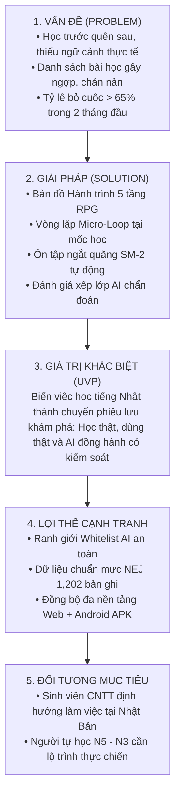
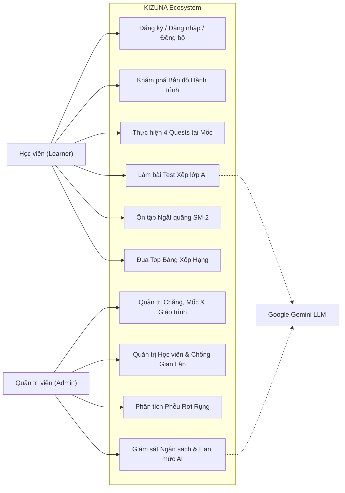

# 📜 TÀI LIỆU YÊU CẦU SẢN PHẨM TOÀN DIỆN (MASTER PRD)
## DỰ ÁN: KIZUNA (絆) - HÀNH TRÌNH HỌC TIẾNG NHẬT ĐA NỀN TẢNG HỖ TRỢ BỞI AI
**Hệ thống:** KIZUNA E-Learning Ecosystem  
**Phiên bản:** v3.0.0 (Bản Hợp Nhất & Chuẩn Hóa Toàn Diện)  
**Ngày cập nhật:** 2026-11-23  
**Trạng thái:** Authoritative Master Document  

---

## 🧭 1. KHÁM PHÁ SẢN PHẨM & TẦM NHÌN ĐỊNH VỊ (PRODUCT DISCOVERY)

### 1.1. Sứ mệnh & Ý nghĩa Tên gọi "KIZUNA (絆)"
Trong văn hóa Nhật Bản, **KIZUNA (絆 - Đới / Thắt lưng / Gắn kết)** biểu trưng cho mối dây liên kết bền chặt giữa con người với con người, giữa người học với ngôn ngữ và văn hóa xứ sở hoa anh đào. KIZUNA ra đời với sứ mệnh: **Xóa bỏ rào cản học tiếng Nhật thụ động, biến việc học thành chuyến du hành khám phá đầy hứng khởi, nơi người học thực sự "dùng được" tiếng Nhật trong đời sống và công việc**.

### 1.2. Sự chuyển dịch mô hình sản phẩm (Paradigm Shift)
* **Thực trạng mô hình cũ (Danh sách khóa học tĩnh):** Mở ứng dụng là một danh sách khóa học dài dặc (N5, N4, Minna no Nihongo bài 1..50). Người học rơi vào tâm lý cày chứng chỉ thụ động, không thấy được sự tiến bộ gắn liền với đời sống thực tế. Hệ quả: hơn **65% học viên bỏ cuộc ngay trong 2 tháng đầu**.
* **Mô hình KIZUNA (Lộ trình như một Chuyến đi - Journey Map Gamification):**
  * **Người học là một Lữ khách (Traveler):** Khởi hành từ *Chuẩn bị lên đường*, *Bắt đầu khám phá*, *Sinh hoạt hằng ngày* cho đến *Đi làm tại Nhật Bản*.
  * **Giáo trình là mỏ tri thức (Raw Knowledge Sources):** Đội ngũ sản phẩm chắt lọc giáo trình chuẩn (NEJ - A New Approach to Elementary Japanese Vol 1 & 2) thành các **Chặng (Stages)** và **Mốc (Milestones)** trực quan trên bản đồ.
  * **Gameplay phục vụ việc học (Meaningful Gamification):** Người học chỉ mở khóa mốc mới khi **thực sự dùng được kiến thức** (nghe hiểu, tự viết câu, vượt qua bài tập tình huống thực tế), tích lũy **Điểm Năng Động (Active Points)** và duy trì **Chuỗi Streak**.

---

### 1.3. Khung Tinh Gọn Lean Canvas (Lean Canvas Model)



---

### 1.4. Phân Tích Đối Thủ Cạnh Tranh (Competitive Benchmarking)

| Tiêu chí so sánh | Anki | Duolingo | Mazii | **KIZUNA (Giải pháp của chúng ta)** |
| :--- | :--- | :--- | :--- | :--- |
| **Mô hình trải nghiệm** | Thẻ flashcard khô khan, tự nhập liệu | Game hóa ngắn nhưng câu hỏi lặp vô nghĩa | Từ điển và luyện đề thi tĩnh | **Bản đồ Hành trình RPG (Hành trình → Chặng → Mốc → Quests)** |
| **Cơ chế mở khóa** | Không có bản đồ tiến trình | Vượt bài tập tích lũy vương miện | Tự chọn bài tùy ý | **Vượt thử thách thực tế tại mốc mới mở đường đi tiếp** |
| **Ứng dụng AI** | ❌ Không tích hợp | ⚠️ Có phí cao (Duolingo Max) | ⚠️ Dịch máy đơn thuần | ✅ **Gemini AI chẩn đoán xếp lớp & Hàng rào Whitelist an toàn** |
| **Cơ chế ôn lỗi sai** | Ôn thẻ theo thuật toán SM-2 | Ôn ngẫu nhiên | Không có cơ chế tự động | ✅ **"Nhiệm vụ quay lại luyện tập" hiển thị trực quan trên bản đồ** |
| **Đa nền tảng** | Cần sync thủ công, UI cũ | Web + Mobile | Web + App nhưng rời rạc | ✅ **Đồng bộ thời gian thực Web React + Mobile Android APK qua Firestore** |

---

### 1.5. Bản Đồ Thấu Cảm (Empathy Map) & Persona Đại Diện

#### Persona: Lê Hoàng Nam (20 tuổi, Sinh viên năm 2 ngành CNTT)
* **Mục tiêu:** Giao tiếp tự tin và đạt N4/N3 để tham gia chương trình thực tập kỹ sư cầu nối (BrSE) tại Tokyo/Fukuoka.
* **Nói & Làm (Say & Do):** *"Mình tải nhiều app về nhưng chỉ học được vài ngày là nản vì danh sách bài dài quá. Mình muốn học câu nào là phải áp dụng nói chuyện được ngay với người Nhật."*
* **Nghĩ & Cảm thấy (Think & Feel):** Lo lắng khi nhìn vào 50 bài ngữ pháp khô cứng; hào hứng khi thấy nhân vật của mình tiến lên từng bước trên bản đồ.
* **Điểm đau (Pains):** Học từ vựng riêng rẽ nhưng không biết ghép vào tình huống thật; bị phạt làm lại cả bài dài chỉ vì quên vài chữ Hán.
* **Kỳ vọng (Gains):** Cảm giác như đang "chơi game vượt ải", sai từ nào thì hệ thống chỉ nhắc ôn lại đúng từ đó vào ngày hôm sau.

---

## 🗺️ 2. KIẾN TRÚC HÀNH TRÌNH 5 CẤP ĐỘ & MÔ HÌNH GIÁO TRÌNH

### 2.1. Cấu trúc Phân cấp 5 Tầng (5-Tier Architecture)
```
Hành trình (Journey)
   └── Chặng (Stage: 4 Chặng lớn)
         └── Mốc (Milestone: 28 Mốc chuẩn hóa NEJ Vol 1 & 2)
               └── Bài học bắt buộc (Milestone Quests: 4 Quests / Mốc = 112 Quests)
                     └── Nhiệm vụ Ôn tập Ngắt quãng (Spaced Re-engagement Quest SM-2)
```

### 2.2. Chi Tiết Lộ Trình 4 Chặng Khám Phá

| Chặng | Tên Chặng & Cấp độ | Mục tiêu Sư phạm | Số Mốc & Nội dung tiêu biểu |
| :---: | :--- | :--- | :--- |
| **Chặng 1** | **Khởi Hành & Chữ Cái (N5)** | Làm quen ngữ âm, nhận diện thành thạo 2 bảng chữ cái Hiragana & Katakana, phát âm chuẩn. | **Mốc 1 - 3:** Nhận diện mặt chữ $\rightarrow$ Ghép âm biến âm $\rightarrow$ Biển hiệu & Từ mượn ngoại lai. |
| **Chặng 2** | **Nền Tảng Giao Tiếp (N5 - NEJ Vol 1)** | Tự giới thiệu bản thân, trường học, gia đình, sở thích, nhịp sống thường nhật và đi chơi cuối tuần. | **Mốc 4 - 15:** 12 Unit cốt lõi NEJ Vol 1. Nắm chắc 350 từ vựng và 150 chữ Hán căn bản. |
| **Chặng 3** | **Đời Sống Thực Tiễn (N4 - NEJ Vol 2)** | Xử lý tình huống: Hỏi đường tàu điện, đổi lịch hẹn, giải thích lý do, mua sắm và giao tiếp nhà hàng. | **Mốc 16 - 25:** 10 Unit đầu NEJ Vol 2. Sử dụng thể Te, thể từ điển, câu nhờ vả lịch sự. |
| **Chặng 4** | **Bứt Phá Năng Lực (N4+ / Tiền N3)** | Bày tỏ ý kiến cá nhân, diễn đạt cảm xúc, chuẩn bị tác phong phỏng vấn và môi trường làm việc Nhật Bản. | **Mốc 26 - 28:** Hoàn thành trọn vẹn NEJ Vol 2, sẵn sàng chinh phục kỳ thi JLPT N4. |

---

## 🎮 3. GAMEPLAY & VÒNG LẶP TRẢI NGHIỆM TẠI MỖI MỐC (MICRO-LOOP)

### 3.1. Vòng lặp 4 Bài học Bắt buộc (4 Quests per Milestone)
Mỗi mốc học tập bao gồm đúng 4 bài học có tính sư phạm chặt chẽ:
1. **Quest 1 - Thẻ ghi nhớ cốt lõi (SRS Flashcard):** Nạp 26 từ vựng và Kanji của mốc. Học viên lật thẻ 2 mặt (Nhật - Việt, âm Hán Việt, cách đọc Hiragana, câu ví dụ). Thưởng **+25 XP, +10 Active Points**.
2. **Quest 2 - Cổng kiểm soát Từ vựng (Vocab Gatekeeper):** Bài kiểm tra trắc nghiệm phản xạ 100%. Yêu cầu đúng trọn vẹn để đảm bảo thuộc từ vựng. Từ làm sai tự động đẩy vào hàng đợi `user_srs_items`. Thưởng **+35 XP, +15 Active Points**.
3. **Quest 3 - Phân tích Ngữ pháp & Cấu trúc (Grammar Deep-Dive):** Nắm vững 2-3 mẫu câu trọng tâm của mốc, giải thích lý do và sắc thái giao tiếp. Thưởng **+45 XP, +20 Active Points**.
4. **Quest 4 - Thử thách Tổng hợp Về đích (Mastery Practice):** Bài tập điền khuyết có gợi ý (`hintOnError`). Hoàn thành Quest 4 sẽ chính thức đổi trạng thái mốc sang `COMPLETED`, mở khóa mốc kế tiếp. Thưởng **+50 XP, +25 Active Points**.

### 3.2. Thuật toán Lặp lại Ngắt quãng SuperMemo SM-2
* Mọi từ vựng hoặc Kanji học viên làm sai tại Gatekeeper sẽ được nạp vào hàng đợi ôn tập riêng biệt `user_srs_items`.
* Khoảng thời gian giãn cách ôn tập:
  $$I(1) = 1 \text{ ngày}, \quad I(2) = 6 \text{ ngày}, \quad I(n) = I(n-1) \times EF$$
* Hệ số dễ nhớ ($EF$) tự động điều chỉnh theo đánh giá độ nhớ (thang điểm 0 - 5) với cận dưới an toàn $EF \ge 1.3$:
  $$EF' = \max\left(1.3, \; EF + (0.1 - (5 - q) \times (0.08 + (5 - q) \times 0.02))\right)$$

---

## 🤖 4. RANH GIỚI KIỂM SOÁT AI CÓ TRÁCH NHIỆM (RESPONSIBLE AI)

Hệ thống thiết lập ranh giới 3 lớp bảo vệ nghiêm ngặt:
1. **Lớp Tri thức Chuẩn (Human-Curated Knowledge Base - 100% Deterministic):** Con người làm chủ toàn bộ 28 mốc, 728 từ vựng và 300 Kanji chuẩn giáo trình NEJ.
2. **Ranh giới Whitelist (Knowledge Whitelist Guardrail):** Mọi tác vụ AI chỉ được phép tham chiếu trong phạm vi 26 từ vựng và mẫu câu của mốc đó, tuyệt đối không dùng từ vựng N2/N1 gây quá tải nhận thức.
3. **Kiểm soát Ngân sách & Tải trọng (Operational Guardrails):**
   * Giới hạn `dailyLimit = 100 lượt gọi/ngày` để bảo vệ chi phí.
   * `Semaphore inFlight = 2` chống cạn kiệt tài nguyên server.
   * `Timeout = 5 giây` kèm cơ chế Fallback tự động sang thuật toán nội bộ nếu AI gặp sự cố.

---

## 📊 5. PHÂN TÍCH YÊU CẦU THEO CHUẨN FURPS+ (ISO/IEC 25010)

* **F - Functionality (Chức năng):**
  * Bản đồ hành trình 4 Chặng, 28 Mốc với trạng thái `LOCKED`, `UNLOCKED`, `COMPLETED`.
  * Bộ công cụ ôn tập SM-2 tự động theo ngày.
  * AI Chẩn đoán xếp lớp đầu vào qua Gemini API.
  * Bảng xếp hạng Điểm Năng Động (Weekly & All-time).
* **U - Usability (Khả năng sử dụng):**
  * Giao diện Bento Box hiện đại, hỗ trợ Dark/Light Mode.
  * Phông chữ chuẩn tiếng Nhật Noto Sans JP, âm Hán Việt in hoa rõ nét.
  * Thao tác 1 chạm tối ưu cho màn hình cảm ứng di động.
* **R - Reliability (Độ tin cậy):**
  * Dữ liệu tiến trình người dùng cách ly hoàn toàn với giáo trình gốc.
  * Cơ chế Fallback đảm bảo không gián đoạn học tập khi mất kết nối mạng.
* **P - Performance (Hiệu năng):**
  * Thời gian tải bản đồ hành trình $< 300\text{ms}$.
  * Phản hồi API Gemini xếp lớp $< 2.5\text{s}$.
  * Bundle Frontend nén $< 500\text{KB}$.
* **S - Supportability (Khả năng bảo trì):**
  * Backend Spring Boot 3.4 thiết kế Clean Architecture phân tầng rõ rệt.
  * Frontend React TypeScript phân tách Component, Service và Types độc lập.

---

## 👥 6. MÔ HÌNH HÓA TRƯỜNG HỢP SỬ DỤNG (USE CASE MODELING)



---

## 📝 7. DANH MỤC USER STORIES CHUẨN INVEST & TIÊU CHÍ GHERKIN

### US-01: Khám Phá Bản Đồ Hành Trình Trực Quan (Must-Have - 3 SP)
* **Story:** Là một *học viên*, tôi muốn *nhìn thấy lộ trình học dưới dạng bản đồ uốn lượn qua các chặng và cột mốc*, để *luôn biết mình đang ở đâu và còn bao xa để tới đích*.
* **Acceptance Criteria (Gherkin):**
  ```gherkin
  Scenario: Học viên mới mở bản đồ lần đầu
    Given Học viên đã đăng nhập thành công
    When Học viên truy cập trang Bản đồ
    Then Hệ thống hiển thị Mốc 1 ở trạng thái "UNLOCKED"
    And Tất cả các Mốc còn lại hiển thị biểu tượng ổ khóa "LOCKED"
  ```

### US-02: Vượt Thử Thách Cổng Gatekeeper (Must-Have - 5 SP)
* **Story:** Là một *học viên*, tôi muốn *hoàn thành bài trắc nghiệm Gatekeeper đúng 100%*, để *chắc chắn mình đã thuộc toàn bộ từ vựng trước khi chuyển sang học ngữ pháp*.
* **Acceptance Criteria (Gherkin):**
  ```gherkin
  Scenario: Học viên trả lời sai từ vựng tại Gatekeeper
    Given Học viên đang làm bài Quest 2 (Gatekeeper)
    When Học viên chọn sai nghĩa của từ vựng
    Then Hệ thống tự động ghi nhận từ đó vào "user_srs_items"
    And Yêu cầu học viên làm lại câu hỏi sai trước khi cho phép qua bài
  ```

### US-03: Chẩn Đoán & Xếp Lớp Đầu Vào Bằng AI (Must-Have - 5 SP)
* **Story:** Là một *học viên đã có kiến thức nền*, tôi muốn *làm bài test chẩn đoán đầu vào để AI gợi ý cột mốc xuất phát phù hợp*, để *không phải học lại những kiến thức đã biết*.
* **Acceptance Criteria (Gherkin):**
  ```gherkin
  Scenario: Xếp lớp thành công qua Gemini
    Given Học viên hoàn thành bài test chẩn đoán
    When Hệ thống gửi điểm các kỹ năng lên API Gemini
    Then Gemini phân tích và trả về milestoneId kèm mức độ tin cậy "HIGH/MODERATE/LOW"
    And Hệ thống tự động mở khóa các mốc trước đó cho học viên
  ```

### US-04: Ôn Tập Thẻ Đến Hạn SM-2 (Should-Have - 3 SP)
* **Story:** Là một *học viên*, tôi muốn *nhận được danh sách các thẻ từ vựng đến hạn ôn tập mỗi ngày*, để *ghi nhớ kiến thức lâu dài vào trí nhớ dài hạn*.
* **Acceptance Criteria (Gherkin):**
  ```gherkin
  Scenario: Hoàn thành phiên ôn tập thẻ hôm nay
    Given Học viên có 10 thẻ trong hàng đợi đến hạn
    When Học viên lật thẻ và đánh giá độ nhớ từ 0 đến 5 sao
    Then Hệ thống tính lại intervalDays theo công thức SM-2
    And Cộng thưởng +5 Active Points cho mỗi thẻ ôn tập
  ```

### US-05: Quản Trị Chống Gian Lận Bảng Xếp Hạng (Must-Have - 5 SP)
* **Story:** Là một *quản trị viên*, tôi muốn *kiểm tra hồ sơ học viên, reset chuỗi streak hoặc trừ điểm năng động khi phát hiện sửa giờ thiết bị*, để *bảo vệ tính công bằng của bảng xếp hạng*.
* **Acceptance Criteria (Gherkin):**
  ```gherkin
  Scenario: Admin can thiệp xử phạt gian lận
    Given Admin mở Drawer thanh tra của học viên vi phạm
    When Admin bấm nút "Reset Streak về 0" và nhập lý do
    Then Hệ thống cập nhật streak = 0 và đồng bộ tức thì lên Leaderboard
  ```
