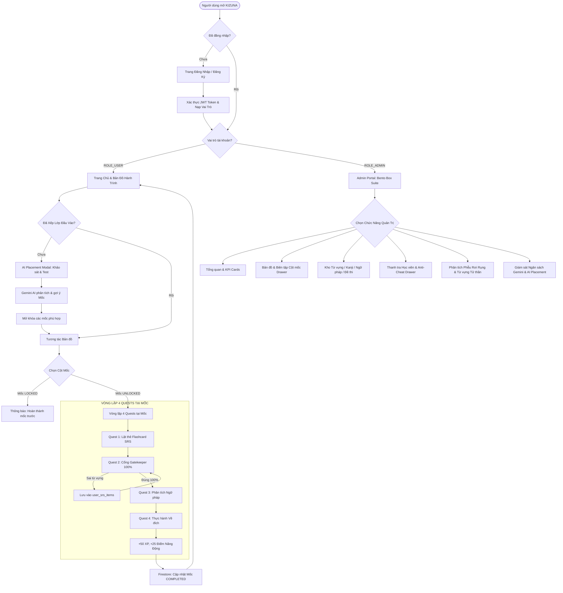

# 🎨 ĐẶC TẢ THIẾT KẾ UX/UI & HỆ THỐNG GIAO DIỆN (DESIGN SYSTEM)
## DỰ ÁN: KIZUNA (絆) - HÀNH TRÌNH HỌC TIẾNG NHẬT ĐA NỀN TẢNG HỖ TRỢ BỞI AI
**Hệ thống:** KIZUNA Multi-Platform Client & Admin Desktop Portal  
**Phiên bản:** v3.0.0 (Bản Chuẩn Hóa Toàn Diện)  
**Ngày cập nhật:** 2026-11-23  

---

## 🧭 1. TRIẾT LÝ THIẾT KẾ: "CUỘC PHIÊU LƯU KHÔNG MA SÁT" (FRICTIONLESS ODYSSEY)

Trải nghiệm người dùng trong KIZUNA xóa bỏ hoàn toàn cảm giác "ngồi học bài" khô cứng và thay thế bằng trải nghiệm **nhập vai vào một chuyến du ngoạn khám phá văn hóa & ngôn ngữ Nhật Bản**:
1. **Khám phá Tự nhiên (Natural Exploration):** Người học luôn nhìn thấy toàn cảnh vị trí của mình trên bản đồ Nhật Bản (Overworld Map), thấy đích đến tiếp theo và các vùng đất đã chinh phục.
2. **Vòng lặp Vi mô Tinh gọn (Micro-Loop):** Mỗi cột mốc được chia nhỏ thành 4 bài học (Quests) từ 3 đến 5 phút, phù hợp với nhịp học ngắt quãng trên thiết bị di động.
3. **Phục hồi Nhẹ nhàng (Forgiving Recovery):** Khi làm sai, người học không bị phạt nặng mà hệ thống nhẹ nhàng đưa từ sai vào *Hàng đợi ôn tập ngắt quãng SM-2* để nhắc lại vào ngày thích hợp.
4. **Song hành Hai Không Gian (Dual Space Design):**
   * **Phân hệ User:** Tối ưu 100% cho màn hình cảm ứng di động (Mobile Web & Android APK).
   * **Phân hệ Admin:** Thiết kế Bento Box hiện đại trên máy tính (Desktop Web), tối ưu cho giáo viên và quản trị viên vận hành dữ liệu lớn.

---

## 🗺️ 2. SƠ ĐỒ LUỒNG NGƯỜI DÙNG TỔNG THỂ (MASTER USER FLOW)

---

## 📱 3. THIẾT KẾ PHÂN HỆ NGƯỜI HỌC (USER CLIENT UX/UI)

### 3.1. Thanh Trạng Thái Gamification Cố Định (Player Status Bar)
* **Chuỗi học tập (Streak Flame 🔥):** Hiển thị số ngày học liên tục. Nhấn vào mở lịch điểm danh các ngày trong tuần.
* **Điểm Năng Động (Active Points Lightning ⚡):** Điểm số tích lũy được khi làm bài để leo Bảng Xếp Hạng. Có animation nhảy số sinh động khi nhận thưởng.
* **Huy hiệu Cấp độ (Level Badge):** Tân binh $\rightarrow$ JLPT N5 $\rightarrow$ N4 $\rightarrow$ N3.
* **Avatar người học:** Tải ảnh đại diện hoặc avatar ngẫu nhiên Dicebear.

### 3.2. Bản Đồ Hành Trình Trực Quan (Japan Overworld Map)
* Thiết kế đường uốn lượn liên kết các nút mốc (Winding Journey Path).
* Phân định 4 vùng chặng với màu sắc đại diện:
  * **Chặng 1:** Sắc Xanh Trà Non (`Emerald / Teal`) - Khởi hành.
  * **Chặng 2:** Sắc Xanh Dương (`Sky / Blue`) - Nền tảng đời sống.
  * **Chặng 3:** Sắc Cam Hổ Phách (`Amber / Orange`) - Thực tế giao tiếp.
  * **Chặng 4:** Sắc Đỏ Son Torii (`Rose / Crimson`) - Bứt phá công sở.
* Hiệu ứng trạng thái mốc:
  * **Mốc đã xong:** Vương miện vàng, nền xanh lá, nối đường sáng đèn.
  * **Mốc đang học:** Hiệu ứng nhịp thở (`pulse animation`), cắm cờ vị trí của học viên.
  * **Mốc bị khóa:** Nút xám mờ kèm icon ổ khóa.

### 3.3. Modal Chẩn Đoán & Xếp Lớp AI (AiPlacementModal)
* Quy trình 4 bước tinh tế:
  1. **Khảo sát định hướng (Screening):** Chọn mục tiêu (giao tiếp, đi làm, thi JLPT) và số giờ học/tuần.
  2. **Bộ đề chẩn đoán thích ứng (Adaptive Diagnostic Quiz):** 4 câu hỏi trắc nghiệm / cấp độ (từ N5 đến N1). Trả lời đạt $\ge 75\%$ tự động đẩy lên cấp tiếp theo.
  3. **Đánh giá AI (Evaluating):** Hiệu ứng Shimmer trong lúc Gemini phân tích ma trận điểm kỹ năng.
  4. **Kết quả xếp lớp (Result):** Huy hiệu cấp độ đạt được, cột mốc gợi ý xuất phát kèm nhãn độ tin cậy của AI: `Độ tin cậy theo Gemini: Cao (High)` hoặc `Vừa (Moderate)`.

---

## 🖥️ 4. THIẾT KẾ PHÂN HỆ QUẢN TRỊ VIÊN (ADMIN DESKTOP PORTAL)

### 4.1. Kiến Trúc Bố Cục Bento Box (Admin Layout Shell)
* Thiết kế dạng lưới Bento Box hiện đại trên nền giấy Nhật (`Kanji Paper texture`).
* **Sidebar cố định bên trái:** Thu gọn thông minh (270px $\leftrightarrow$ 80px), điều hướng nhanh 11 phân hệ quản trị.
* **Header tinh giản:** Hiển thị thẻ chức danh `ROLE_ADMIN`, avatar, nút chuyển đổi nhanh chế độ Sáng / Tối (`Dark / Light Mode`), và nút chuyển sang giao diện User để test bài.

### 4.2. Các Thành Phần Trọng Tâm Của Admin
1. **Thanh Tra Học Viên (`UserInspectorDrawer`):**
   * Drawer trượt từ cạnh phải màn hình hiển thị toàn bộ hồ sơ học tập.
   * Tab Profile: Đổi vai trò `ROLE_ADMIN` $\leftrightarrow$ `ROLE_USER`, Khóa tài khoản (Ban).
   * Tab Anti-Cheat: Nút Reset Streak về 0, nhập ô cộng/trừ Điểm Năng Động kèm lý do.
   * Tab Dossier: Danh mục mốc đã hoàn thành, số lượng thẻ ôn tập SM-2 đang chờ, danh sách từ học viên hay làm sai.
2. **Quản Trị Mốc Học & Whitelist (`MilestoneManagerDrawer`):**
   * Quản lý thông tin mốc, bật/tắt hiển thị (`isActive`), cân bằng điểm thưởng (`xpReward`, `activePointsReward`).
   * Xem và bổ sung nhanh từ vựng vào Whitelist tri thức của mốc.
3. **Phân Tích Phễu Rơi Rụng (`LearningAnalyticsView`):**
   * Biểu đồ phễu trực quan hóa tỷ lệ học viên rơi rụng từ Mốc 1 đến Mốc 28.
   * Đánh dấu mốc nghẽn (`isBottleneck`) khi tỷ lệ rơi rụng vượt quá $20\%$.
   * Bảng xếp hạng Top Từ vựng và Kanji "Tử thần" có số lần chọn sai cao nhất.

---

## 🎨 5. HỆ THỐNG THIẾT KẾ (DESIGN SYSTEM & TOKENS)

### 5.1. Bảng Màu Chủ Đạo (Color Palette)

| Tên Token | Mã Hex (Light Mode) | Mã Hex (Dark Mode) | Ý nghĩa & Ứng dụng |
| :--- | :--- | :--- | :--- |
| **Matcha Primary** | `#059669` (Emerald 600) | `#10B981` (Emerald 500) | Màu thương hiệu chính: Nút hành động, thanh tiến độ, mốc hoàn thành. |
| **Matcha Soft** | `#ECFDF5` (Emerald 50) | `#064E3B` (Emerald 900/30) | Nền thẻ bài học, điểm nhấn nhẹ nhàng. |
| **Canvas Background** | `#F8FAFC` (Slate 50) | `#020617` (Slate 950) | Nền trang tổng thể, mô phỏng vân giấy Washi. |
| **Card Surface** | `#FFFFFF` (White) | `#0F172A` (Slate 900) | Bề mặt các thẻ Bento Box, Modal, Drawer. |
| **Text Primary** | `#0F172A` (Slate 900) | `#F8FAFC` (Slate 50) | Tiêu đề chính, văn bản có độ tương phản cao. |
| **Text Secondary** | `#64748B` (Slate 500) | `#94A3B8` (Slate 400) | Phụ đề, nhãn hướng dẫn, metadata. |
| **Amber Warning** | `#D97706` (Amber 600) | `#F59E0B` (Amber 500) | Cảnh báo gian lận, điểm nghẽn phễu học tập. |
| **Rose Danger** | `#E11D48` (Rose 600) | `#F43F5E` (Rose 500) | Lỗi sai Gatekeeper, khóa tài khoản, từ vựng tử thần. |

### 5.2. Kiểu Chữ (Typography)
* **Chữ Nhật (Japanese Script):** `Noto Sans JP`, `Hiragino Kaku Gothic Pro`, `Meiryo`, `sans-serif`. Đảm bảo các nét chữ Kanji, Hiragana hiển thị chuẩn mực thư pháp, không bị méo nét.
* **Chữ La-tinh & Số (UI Text):** `Inter`, `system-ui`, `-apple-system`, `sans-serif`. Các chỉ số điểm kinh nghiệm, Active Points hiển thị font số tròn trịa, hiện đại.

---

## 🛡️ 6. PHÂN TÍCH NGOẠI LỆ & LUỒNG PHỤC HỒI (EDGE CASES & ERROR RECOVERY)

| Mã ngoại lệ | Tình huống phát sinh | Phản ứng giao diện (UI Response) | Luồng phục hồi (Recovery Flow) |
| :---: | :--- | :--- | :--- |
| **ERR-NET** | Mất kết nối internet đột ngột khi đang làm Quest | Hiển thị Banner vàng: *"Đang ở chế độ ngoại tuyến. Tiến độ sẽ được đồng bộ khi có mạng."* | Dữ liệu làm bài tạm lưu vào LocalStorage; tự động đẩy lên Firestore khi sự kiện `window.online` kích hoạt. |
| **ERR-AI-TIMEOUT** | Gemini API phản hồi quá 5 giây khi test xếp lớp | Modal chuyển trạng thái chờ sang thông báo nhẹ: *"Đang áp dụng thuật toán phân loại dự phòng..."* | Hệ thống dùng thuật toán chấm điểm thuần để mở khóa mốc tương ứng, không làm học viên bị kẹt màn hình. |
| **ERR-AI-429** | Chạm ngưỡng giới hạn 100 lượt gọi Gemini/ngày | Giao diện xếp lớp vẫn thông báo thành công dựa trên kết quả trắc nghiệm | Ghi log vào hệ thống quản trị để Admin theo dõi việc tăng quota. |
| **ERR-AUTH-403** | Học viên cố tình truy cập URL `/admin` | Render trang `AdminForbidden403.tsx` với huy hiệu cảnh báo bảo mật | Cung cấp 2 nút: "Về Trang Chủ" và "Đăng nhập bằng tài khoản Quản trị viên". |
