# 🗄️ THIẾT KẾ CƠ SỞ DỮ LIỆU & LƯỢC ĐỒ THỰC THỂ (DATABASE ARCHITECTURE & ERD)
## DỰ ÁN: KIZUNA (絆) - HỆ THỐNG HỌC TIẾNG NHẬT ĐA NỀN TẢNG HỖ TRỢ BỞI AI
**Hệ quản trị CSDL:** Google Cloud Firestore (NoSQL Document Store)  
**Phiên bản:** v3.0.0 (Bản Chuẩn Hóa Toàn Diện)  
**Ngày cập nhật:** 2026-11-23  

---

## 🏛️ 1. CHIẾN LƯỢC PHÂN VÙNG DỮ LIỆU (DATABASE PARTITIONING STRATEGY)

Hệ thống cơ sở dữ liệu KIZUNA được tổ chức thành **4 phân vùng logic độc lập** nhằm đảm bảo hiệu năng cao, cách ly dữ liệu cá nhân hóa và bảo vệ toàn vẹn kho giáo trình gốc:

```
┌──────────────────────────────────────────────────────────────────────────────────────────────────┐
│                                   KIẾN TRÚC CƠ SỞ DỮ LIỆU FIRESTORE                              │
├──────────────────────────────────┬─────────────────────────────────┬─────────────────────────────┤
│ 1. GIÁO TRÌNH TĨNH GỐC           │ 2. ĐỊNH DANH & PHÂN QUYỀN       │ 3. TIẾN TRÌNH CÁCH LY       │
│ (Master Curriculum - Read Only)  │ (Identity & RBAC)               │ (User Progress - Read/Write)│
│ • stages (4 chặng)               │ • users                         │ • user_progress             │
│ • milestones (28 mốc)            │                                 │ • user_srs_items (SM-2)     │
│ • milestone_quests (112 bài)     │                                 │ • leaderboard (Xếp hạng)    │
│ • vocabulary_items (728+ từ)     │                                 │                             │
│ • kanji_dictionary (300 chữ Hán) │                                 │ 4. GIÁM SÁT AI (AUDIT)      │
│ • grammar_items (30 cấu trúc)    │                                 │ • ai_evaluation_audits      │
│ • jlpt_exam_catalog (Kho đề thi) │                                 │                             │
└──────────────────────────────────┴─────────────────────────────────┴─────────────────────────────┘
```

> [!IMPORTANT]
> **Nguyên tắc Cách ly Dữ liệu (Isolation Principle):** Học viên làm bài, tăng điểm hoặc hoàn thành mốc chỉ ghi vào phân vùng `user_progress` và `user_srs_items`. **Tuyệt đối không cập nhật trực tiếp vào collection `milestones` hay `stages` gốc**.

---

## 📊 2. SƠ ĐỒ THỰC THỂ LIÊN KẾT (ENTITY RELATIONSHIP DIAGRAM - ERD)

```mermaid
erDiagram
    USERS ||--o{ USER_PROGRESS : "sở hữu tiến độ (1:N)"
    USERS ||--o{ USER_SRS_ITEMS : "hàng đợi ôn tập (1:N)"
    USERS ||--o| LEADERBOARD : "vị trí xếp hạng (1:1)"
    USERS ||--o{ AI_EVALUATION_AUDITS : "khiếu nại phán quyết (1:N)"

    STAGES ||--o{ MILESTONES : "chứa các cột mốc (1:N)"
    MILESTONES ||--o{ MILESTONE_QUESTS : "gồm 4 bài học (1:4)"
    MILESTONES ||--o{ VOCABULARY_ITEMS : "danh mục từ vựng (1:26)"
    MILESTONES ||--o{ KANJI_DICTIONARY : "chữ Hán của mốc (1:N)"
    MILESTONES ||--o{ GRAMMAR_ITEMS : "mẫu câu của mốc (1:N)"
    MILESTONES ||--o{ AI_EVALUATION_AUDITS : "ngữ cảnh mốc (1:N)"

    USERS {
        string id PK "Mã định danh (UID)"
        string username "Tên tài khoản duy nhất"
        string email "Email liên hệ"
        string fullName "Họ và tên hiển thị"
        string password "Mật khẩu mã hóa BCrypt / SHA-256"
        string role "ROLE_ADMIN hoặc ROLE_USER"
        string status "ACTIVE hoặc BANNED"
        boolean enabled "Trạng thái kích hoạt"
        boolean isDeleted "Cờ xóa mềm"
        string level "Cấp độ: Tân binh, N5, N4, N3"
        int totalXp "Tổng điểm kinh nghiệm"
        int activePoints "Điểm Năng Động leo rank"
        int currentStreak "Chuỗi ngày học liên tục"
        string avatarUrl "Đường dẫn ảnh đại diện"
        timestamp createdAt "Thời điểm tạo tài khoản"
    }

    STAGES {
        string id PK "Mã chặng (vd: stage_01_hiragana)"
        int orderIndex "Thứ tự hiển thị trên bản đồ"
        string title "Tiêu đề chặng"
        string subtitle "Phụ đề chặng"
        string jlptLevel "Cấp độ JLPT tương ứng (N5..N3)"
        string themeColor "Mã màu đại diện Hex"
        int milestonesCount "Tổng số mốc thuộc chặng"
        string description "Mô tả mục tiêu của chặng"
    }

    MILESTONES {
        string id PK "Mã mốc (vd: ms_s2_u01_self_intro)"
        string stageId FK "Khóa ngoại trỏ về stages.id"
        int orderIndex "Thứ tự mốc trong lộ trình (1..28)"
        string title "Tiêu đề mốc"
        string nejUnit "Đơn vị bài học theo giáo trình NEJ"
        string communicationContext "Bối cảnh giao tiếp thực tế"
        string canDoGoal "Mục tiêu năng lực Can-do"
        int xpReward "Điểm kinh nghiệm thưởng (mặc định 50)"
        int activePointsReward "Điểm Năng Động thưởng (mặc định 70)"
        string prerequisiteMilestoneId "Mốc điều kiện tiên quyết"
        boolean isActive "Cờ bật/tắt hiển thị của Admin"
    }

    MILESTONE_QUESTS {
        string id PK "Mã bài học"
        string milestoneId FK "Khóa ngoại trỏ về milestones.id"
        int stepIndex "Thứ tự bước trong mốc (1..4)"
        string title "Tên bài học"
        string questType "SRS_FLASHCARD | GATEKEEPER | GRAMMAR | PRACTICE"
        int xpReward "Điểm XP thưởng của bài"
        int activePointsReward "Điểm Năng Động thưởng"
    }

    VOCABULARY_ITEMS {
        string id PK "Mã từ vựng"
        string milestoneId FK "Khóa ngoại trỏ về milestones.id"
        string term "Từ gốc tiếng Nhật (Kanji/Kana)"
        string reading "Cách đọc Hiragana"
        string sinoVietnamese "Âm Hán Việt in hoa"
        string vietnameseMeaning "Nghĩa tiếng Việt chuẩn"
        string exampleSentenceJa "Câu ví dụ tiếng Nhật"
        string exampleSentenceVi "Dịch nghĩa câu ví dụ"
        string level "Cấp độ JLPT (N5..N1)"
    }

    KANJI_DICTIONARY {
        string id PK "Mã chữ Hán (vd: kanji_001_nhat)"
        string milestoneId FK "Khóa ngoại trỏ về milestones.id"
        string kanji "Ký tự chữ Hán gốc"
        string sinoVietnamese "Âm Hán Việt"
        string onyomi "Âm On (Katakana)"
        string kunyomi "Âm Kun (Hiragana)"
        int strokeCount "Số nét vẽ"
        string radical "Bộ thủ chính"
        string vietnameseMeaning "Nghĩa tiếng Việt"
        string mnemonicStory "Câu chuyện mẹo nhớ"
    }

    GRAMMAR_ITEMS {
        string id PK "Mã ngữ pháp"
        string milestoneId FK "Khóa ngoại trỏ về milestones.id"
        string pattern "Mẫu câu cấu trúc"
        string meaning "Ý nghĩa cấu trúc"
        string usageExplanation "Giải thích cách dùng và lý do"
        string naturalNuance "Sắc thái tự nhiên của người Nhật"
    }

    USER_PROGRESS {
        string id PK "Tổ hợp userId_milestoneId"
        string userId FK "Khóa ngoại trỏ về users.id"
        string milestoneId FK "Khóa ngoại trỏ về milestones.id"
        string status "LOCKED | UNLOCKED | IN_PROGRESS | COMPLETED"
        string[] completedQuests "Danh sách mã Quest đã vượt qua"
        int activePointsEarned "Điểm Năng Động đã nhận từ mốc"
        timestamp completedAt "Thời điểm hoàn thành mốc"
    }

    USER_SRS_ITEMS {
        string id PK "Tổ hợp userId_itemId"
        string userId FK "Khóa ngoại trỏ về users.id"
        string itemId "Mã từ vựng hoặc chữ Hán"
        string itemType "VOCABULARY hoặc KANJI"
        int repetition "Số lần ôn tập thành công liên tiếp"
        float easeFactor "Hệ số dễ nhớ SM-2 (mặc định 2.5)"
        int intervalDays "Số ngày giãn cách ôn tập tiếp theo"
        int wrongCount "Số lần làm sai tích lũy"
        timestamp nextReviewDate "Ngày đến hạn ôn tập"
    }

    LEADERBOARD {
        string id PK "Khóa chính bằng users.id"
        string userId FK "Khóa ngoại trỏ về users.id"
        string username "Tên tài khoản hiển thị"
        string fullName "Họ và tên"
        int activePoints "Điểm Năng Động tích lũy"
        int currentStreak "Chuỗi ngày học liên tục"
        int rank "Thứ hạng thời gian thực"
        timestamp updatedAt "Thời điểm cập nhật điểm"
    }

    AI_EVALUATION_AUDITS {
        string id PK "Mã bản ghi kiểm toán"
        string userId FK "Khóa ngoại trỏ về users.id"
        string milestoneId FK "Khóa ngoại trỏ về milestones.id"
        string milestoneTitle "Tiêu đề cột mốc"
        string userSubmission "Bài làm của học viên"
        string aiFeedback "Nhận xét của AI Sensei"
        int aiScore "Điểm số do AI chấm (1..10)"
        string studentAppealReason "Lý do học viên khiếu nại"
        string status "PENDING | APPROVED | REJECTED"
        string adminNote "Ghi chú phán quyết của Admin"
        timestamp submittedAt "Thời điểm gửi bài"
    }
```



---

## 📖 3. TỪ ĐIỂN DỮ LIỆU CHI TIẾT (DATA DICTIONARY)

### 3.1. Collection `users` (Quản lý Định danh & Bảo mật)
| Tên Trường | Kiểu Dữ Liệu | Ràng Buộc | Mô Tả Nghiệp Vụ |
| :--- | :--- | :--- | :--- |
| `id` | `String` | PK, Not Null | UID tài khoản (sinh ngẫu nhiên hoặc từ Firebase Auth). |
| `username` | `String` | Unique, Not Null | Tên định danh tài khoản, không chứa ký tự đặc biệt. |
| `email` | `String` | Indexed, Not Null | Email xác thực và nhận OTP khôi phục mật khẩu. |
| `password` | `String` | Not Null | Mật khẩu đã băm một chiều bằng BCrypt / SHA-256. |
| `role` | `String` | Not Null | Vai trò: `ROLE_ADMIN` hoặc `ROLE_USER`. |
| `status` | `String` | Default: 'ACTIVE' | Trạng thái: `ACTIVE` hoặc `BANNED`. |
| `activePoints` | `Integer` | Min: 0 | Điểm Năng Động leo rank Bảng Xếp Hạng. |
| `currentStreak` | `Integer` | Min: 0 | Số ngày học liên tục không ngắt quãng. |

### 3.2. Collection `user_srs_items` (Hàng đợi Ôn tập Ngắt quãng SM-2)
| Tên Trường | Kiểu Dữ Liệu | Ràng Buộc | Mô Tả Nghiệp Vụ |
| :--- | :--- | :--- | :--- |
| `id` | `String` | PK | Mã duy nhất kết hợp `{userId}_{itemId}`. |
| `userId` | `String` | Indexed | ID học viên sở hữu thẻ ôn tập. |
| `itemId` | `String` | Indexed | ID của từ vựng hoặc chữ Hán cần ôn tập. |
| `repetition` | `Integer` | Default: 0 | Số lần lặp lại liên tiếp thành công ($n$). |
| `easeFactor` | `Float` | Min: 1.3, Def: 2.5 | Hệ số độ nhớ ($EF$), tối thiểu bằng 1.3 để tránh lặp vô tận. |
| `intervalDays` | `Integer` | Default: 1 | Khoảng cách ngày đến lần ôn tiếp theo ($I$). |
| `wrongCount` | `Integer` | Default: 0 | Số lần học viên trả lời sai (phục vụ thống kê từ tử thần). |
| `nextReviewDate` | `Timestamp` | Indexed | Mốc thời gian thẻ đến hạn ôn tập hôm nay. |

---

## ⚡ 4. CHIẾN LƯỢC CHỈ MỤC PHỨC HỢP (COMPOUND INDEXES)

Để đảm bảo mọi câu truy vấn trên giao diện đạt độ trễ $< 50\text{ms}$, hệ thống kích hoạt các Compound Indexes sau trên Firestore:

| Tên Collection | Các Trường Chỉ Mục | Chiều Sắp Xếp | Mục Đích Truy Vấn |
| :--- | :--- | :---: | :--- |
| `user_progress` | `userId` + `status` | `ASC` + `ASC` | Tải nhanh danh sách các mốc đã hoàn thành của một học viên. |
| `user_srs_items`| `userId` + `nextReviewDate` | `ASC` + `ASC` | Lấy các thẻ cần ôn tập hôm nay (`nextReviewDate <= now`). |
| `leaderboard` | `activePoints` + `currentStreak` | `DESC` + `DESC` | Render Bảng Xếp Hạng Top 50 học viên thời gian thực. |
| `milestones` | `stageId` + `orderIndex` | `ASC` + `ASC` | Sắp xếp các mốc tuần tự trên bản đồ hành trình. |
| `vocabulary_items` | `milestoneId` + `level` | `ASC` + `ASC` | Trích xuất Whitelist từ vựng theo mốc phục vụ AI. |

---

## 🔒 5. QUY TẮC BẢO MẬT DỮ LIỆU (FIRESTORE SECURITY RULES)

```javascript
rules_version = '2';
service cloud.firestore {
  match /databases/{database}/documents {
    
    // Hàm trợ giúp kiểm tra xác thực
    function isAuthenticated() {
      return request.auth != null;
    }
    
    // Hàm trợ giúp kiểm tra quyền Quản trị viên
    function isAdmin() {
      return isAuthenticated() && request.auth.token.role == 'ROLE_ADMIN';
    }
    
    // 1. Phân vùng Giáo trình: Mọi người đọc được, chỉ Admin được ghi/xóa
    match /stages/{stageId} { allow read: if true; allow write: if isAdmin(); }
    match /milestones/{milestoneId} { allow read: if true; allow write: if isAdmin(); }
    match /milestone_quests/{questId} { allow read: if true; allow write: if isAdmin(); }
    match /vocabulary_items/{vocabId} { allow read: if true; allow write: if isAdmin(); }
    match /kanji_dictionary/{kanjiId} { allow read: if true; allow write: if isAdmin(); }
    match /grammar_items/{grammarId} { allow read: if true; allow write: if isAdmin(); }
    
    // 2. Phân vùng Tiến trình Học tập: Học viên chỉ đọc/ghi dữ liệu của chính mình
    match /user_progress/{progressId} {
      allow read, write: if isAuthenticated() && (resource == null || resource.data.userId == request.auth.uid || isAdmin());
    }
    
    match /user_srs_items/{srsId} {
      allow read, write: if isAuthenticated() && (resource == null || resource.data.userId == request.auth.uid || isAdmin());
    }
    
    // 3. Bảng Xếp Hạng: Mọi người đọc, chỉ chính chủ cập nhật điểm của mình
    match /leaderboard/{userId} {
      allow read: if true;
      allow write: if isAuthenticated() && (request.auth.uid == userId || isAdmin());
    }
  }
}
```
