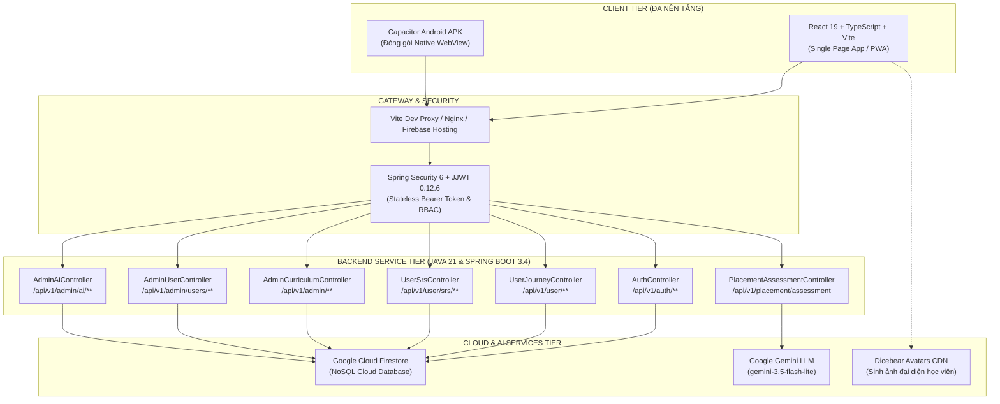

# ⚙️ KIẾN TRÚC KỸ THUẬT HỆ THỐNG & ĐẶC TẢ API (SYSTEM ARCHITECTURE & API SPECS)
## DỰ ÁN: KIZUNA (絆) - HỆ THỐNG HỌC TIẾNG NHẬT ĐA NỀN TẢNG HỖ TRỢ BỞI AI
**Hệ thống:** KIZUNA Technical Specification  
**Phiên bản:** v3.0.0 (Bản Chuẩn Hóa Toàn Diện)  
**Ngày cập nhật:** 2026-11-23  

---

## 🏛️ 1. KIẾN TRÚC TỔNG THỂ HỆ THỐNG (SYSTEM ARCHITECTURE OVERVIEW)

KIZUNA được xây dựng theo kiến trúc phân tán hiện đại, tách biệt hoàn toàn giữa tầng Trải nghiệm Đa nền tảng (Frontend Client), tầng Dịch vụ Xử lý Nghiệp vụ & Bảo mật (Spring Boot Backend), và tầng Lưu trữ Đám mây (Google Cloud Firestore & Gemini API):



---

## 🛡️ 2. BẢO MẬT & PHÂN QUYỀN (JWT & RBAC SPECIFICATION)

### 2.1. Cơ chế Xác thực Stateless JWT (JSON Web Token)
* Sử dụng thư viện **JJWT 0.12.6** với giải thuật ký điện tử `HMAC-SHA256`.
* Token được client đính kèm qua HTTP Header: `Authorization: Bearer <jwtToken>`.
* Bộ lọc `JwtAuthenticationFilter` giải mã token, nạp thông tin quyền hạn vào `SecurityContextHolder`.

### 2.2. Ma Trận Phân Quyền Vai Trò (Role-Based Access Control)
| Nhóm Endpoint | Quyền hạn yêu cầu | Xử lý khi vi phạm |
| :--- | :---: | :--- |
| `/api/v1/auth/**`, `/api/v1/health` | Mọi người (Public) | Cho phép truy cập không cần token. |
| `/api/v1/placement/assessment` | Public / Authenticated | Giới hạn 100 lượt gọi/ngày toàn hệ thống. |
| `/api/v1/user/**` | `ROLE_USER` hoặc `ROLE_ADMIN` | `401 Unauthorized` nếu chưa đăng nhập. |
| `/api/v1/admin/**` | **Bắt buộc `ROLE_ADMIN`** | `403 Forbidden` (`JwtAccessDeniedHandler`). |

---

## 🤖 3. KIẾN TRÚC TÍCH HỢP AI GEMINI LIVE API

Hệ thống tích hợp Google Gemini API phục vụ chẩn đoán năng lực học viên tại [`PlacementAssessmentController.java`](file:///d:/Documents/KIZUNA/backend/src/main/java/com/kizuna/controller/PlacementAssessmentController.java):

```
┌─────────────────────────────────────────────────────────────────────────────────┐
│                           GEMINI PLACEMENT PIPELINE                             │
├─────────────────────────────────────────────────────────────────────────────────┤
│ 1. Client gửi: { levels: [N5..N1 scores by skills], candidates: [28 mốc] }      │
│ 2. Backend kiểm tra:                                                            │
│    • In-Flight Semaphore: Tối đa 2 request song song (chống cạn kiệt luồng)    │
│    • Daily Budget: Kiểm tra callsToday < dailyLimit (100 calls/ngày)            │
│ 3. Tạo Payload JSON gửi Google Endpoint:                                        │
│    https://generativelanguage.googleapis.com/v1beta/models/{model}:generateContent│
│    • Model: gemini-3.5-flash-lite (tốc độ cao, chi phí tối ưu)                 │
│    • Temperature: 0.0 (tính xác định cao, không hallucination)                  │
│    • ResponseSchema: { confidence: ENUM(LOW, MODERATE, HIGH), milestoneId: STR } │
│ 4. Nhận phản hồi & đo độ trễ LatencyMs $\rightarrow$ Trả kết quả cho Client       │
└─────────────────────────────────────────────────────────────────────────────────┘
```

---

## 📚 4. DANH MỤC RESTFUL API ENDPOINTS CHI TIẾT

### 4.1. Phân Hệ Xác Thực & Tài Khoản (Authentication APIs)
| Method | Endpoint | Quyền hạn | Mô tả chức năng |
| :---: | :--- | :---: | :--- |
| `POST` | `/api/v1/auth/login` | Public | Đăng nhập tài khoản, trả về JWT Token và thông tin User. |
| `POST` | `/api/v1/auth/register` | Public | Đăng ký tài khoản học viên mới. |
| `GET` | `/api/v1/auth/me` | Auth | Lấy thông tin tài khoản hiện tại từ Token. |
| `GET` | `/api/v1/health` | Public | Kiểm tra trạng thái sống của Server. |

### 4.2. Phân Hệ Học Viên & Tiến Trình (User Journey APIs)
| Method | Endpoint | Quyền hạn | Mô tả chức năng |
| :---: | :--- | :---: | :--- |
| `GET` | `/api/v1/user/journey/map` | `ROLE_USER` | Lấy toàn bộ 4 chặng và 28 mốc kèm trạng thái cá nhân (`LOCKED`, `UNLOCKED`, `COMPLETED`). |
| `GET` | `/api/v1/user/milestones/{id}/quests` | `ROLE_USER` | Lấy chi tiết 4 bài học Quests của mốc (chỉ mở khi mốc không bị khóa). |
| `POST` | `/api/v1/user/milestones/{id}/quests/{index}/submit` | `ROLE_USER` | Nộp bài Quest, tính điểm thưởng XP & Active Points, mở khóa mốc tiếp theo. |
| `GET` | `/api/v1/user/srs/today` | `ROLE_USER` | Lấy danh sách thẻ từ vựng/kanji đến hạn ôn tập hôm nay theo SM-2. |
| `POST` | `/api/v1/user/srs/{itemId}/review` | `ROLE_USER` | Gửi đánh giá độ nhớ thẻ (0-5 sao), tính lại `intervalDays` và `easeFactor`. |
| `GET` | `/api/v1/leaderboard` | Public/Auth | Bảng xếp hạng Top 50 học viên theo Điểm Năng Động. |

### 4.3. Phân Hệ AI Chẩn Đoán Xếp Lớp (AI Placement API)
| Method | Endpoint | Quyền hạn | Mô tả chức năng |
| :---: | :--- | :---: | :--- |
| `POST` | `/api/v1/placement/assessment` | Public/Auth | Gửi kết quả trắc nghiệm lên Gemini, nhận đề xuất mốc xuất phát và độ tin cậy. |

### 4.4. Phân Hệ Quản Trị Giáo Trình & Gameplay (Admin Curriculum APIs)
| Method | Endpoint | Quyền hạn | Mô tả chức năng |
| :---: | :--- | :---: | :--- |
| `GET, POST, PUT, DELETE` | `/api/v1/admin/stages` | `ROLE_ADMIN` | Toàn quyền CRUD 4 Chặng học. |
| `GET, POST, PUT, DELETE` | `/api/v1/admin/milestones` | `ROLE_ADMIN` | Toàn quyền CRUD 28 Cột mốc. |
| `PATCH` | `/api/v1/admin/milestones/{id}/status` | `ROLE_ADMIN` | Bật/tắt hiển thị mốc (`isActive: true/false`). |
| `PUT` | `/api/v1/admin/milestones/{id}/gameplay-config` | `ROLE_ADMIN` | Cân bằng điểm `xpReward`, `activePointsReward`, mốc tiên quyết. |
| `GET, POST, PUT, DELETE` | `/api/v1/admin/vocabulary` | `ROLE_ADMIN` | Quản lý kho 728+ từ vựng. |
| `GET, POST, PUT, DELETE` | `/api/v1/admin/kanji` | `ROLE_ADMIN` | Quản lý kho 300 Chữ Hán mục tiêu. |
| `GET` | `/api/v1/admin/milestones/{id}/whitelist` | `ROLE_ADMIN` | Trích xuất 26 từ vựng & mẫu câu làm Whitelist tri thức cho AI. |
| `POST` | `/api/v1/admin/milestones/{id}/whitelist/item` | `ROLE_ADMIN` | Bổ sung nhanh 1 từ vựng vào Whitelist mốc. |

### 4.5. Phân Hệ Quản Trị Học Viên & Anti-Cheat (Admin User Operations)
| Method | Endpoint | Quyền hạn | Mô tả chức năng |
| :---: | :--- | :---: | :--- |
| `GET, POST, PUT, DELETE` | `/api/v1/admin/users` | `ROLE_ADMIN` | Toàn quyền CRUD tài khoản người dùng Firestore. |
| `PUT` | `/api/v1/admin/users/{uid}/role` | `ROLE_ADMIN` | Chuyển đổi vai trò `ROLE_ADMIN` $\leftrightarrow$ `ROLE_USER`. |
| `PUT` | `/api/v1/admin/users/{uid}/status` | `ROLE_ADMIN` | Khóa hoặc kích hoạt tài khoản (`enabled: true/false`). |
| `POST` | `/api/v1/admin/users/{uid}/reset-streak` | `ROLE_ADMIN` | Reset chuỗi streak về 0 khi phát hiện gian lận đổi giờ hệ thống. |
| `POST` | `/api/v1/admin/users/{uid}/adjust-points` | `ROLE_ADMIN` | Can thiệp cộng/trừ Điểm Năng Động (Active Points) ảo. |
| `GET` | `/api/v1/admin/users/{uid}/learning-dossier` | `ROLE_ADMIN` | Thanh tra hồ sơ học tập: Mốc đã xong, thẻ SM-2, từ hay làm sai. |

### 4.6. Phân Hệ Giám Sát AI & Phân Tích (Admin AI & Analytics APIs)
| Method | Endpoint | Quyền hạn | Mô tả chức năng |
| :---: | :--- | :---: | :--- |
| `POST` | `/api/v1/admin/ai/sandbox-test` | `ROLE_ADMIN` | Thử nghiệm Prompt AI với Whitelist và đo độ trễ Latency. |
| `GET` | `/api/v1/admin/ai/audit-queue` | `ROLE_ADMIN` | Lấy hàng đợi khiếu nại của học viên. |
| `POST` | `/api/v1/admin/ai/audit-queue/{id}/resolve` | `ROLE_ADMIN` | Phê duyệt (hoàn điểm cho học viên) hoặc từ chối khiếu nại. |
| `GET` | `/api/v1/admin/ai/metrics` | `ROLE_ADMIN` | Báo cáo số lượt gọi AI, chi phí token ước tính, lỗi 429. |
| `GET` | `/api/v1/admin/analytics/drop-off-funnel` | `ROLE_ADMIN` | Dữ liệu phễu rơi rụng học viên từ Mốc 1 đến Mốc 28. |
| `GET` | `/api/v1/admin/analytics/hardest-items` | `ROLE_ADMIN` | Báo cáo Top Từ vựng và Kanji có tỷ lệ làm sai cao nhất. |
