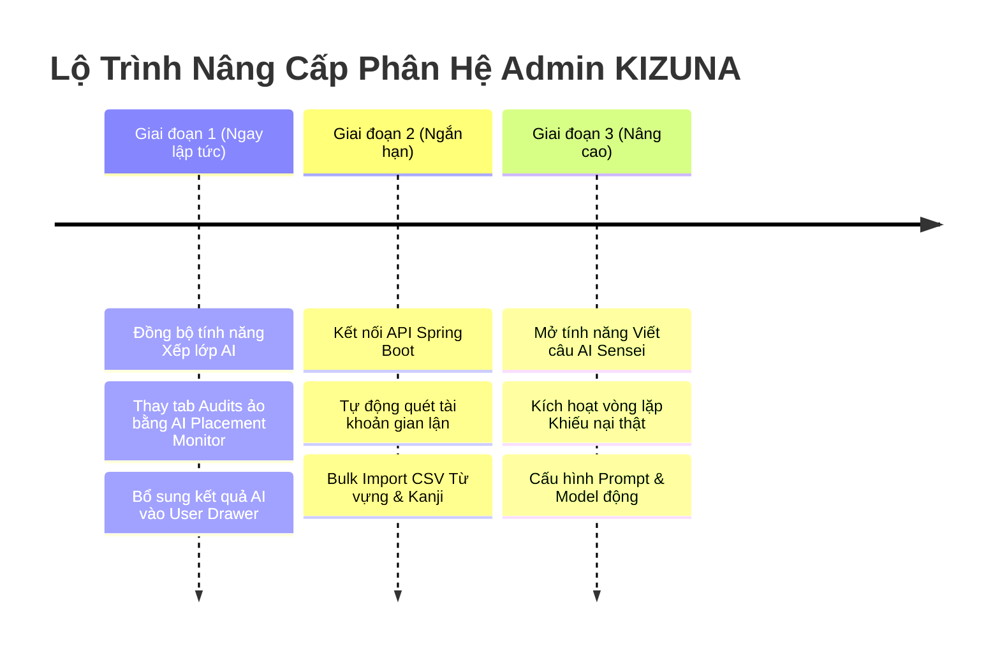

# 🛡️ BÁO CÁO PHÂN TÍCH THIẾU SÓT PHÂN HỆ ADMIN & LỘ TRÌNH ĐỒNG BỘ
## DỰ ÁN: KIZUNA (絆) - HỆ THỐNG HỌC TIẾNG NHẬT ĐA NỀN TẢNG HỖ TRỢ BỞI AI
**Phiên bản tài liệu:** v1.0.0  
**Ngày cập nhật:** 2026-11-23  
**Trạng thái:** Đã đối soát 100% với mã nguồn thực tế (Codebase Ground Truth)

---

## 📌 1. TỔNG QUAN HIỆN TRẠNG PHÂN HỆ ADMIN

Phân hệ Admin của KIZUNA (`AdminDashboardPage.tsx`) đã xây dựng được nền tảng giao diện quản trị Bento Box hiện đại và hệ thống Backend Spring Boot 3.4 tương đối quy chuẩn.

### Những tính năng Admin ĐÃ HOÀN THÀNH tốt:
1. **Quản trị Nội dung Giáo trình (Curriculum Management):**
   * CRUD Chặng học (`stages`) và Cột mốc (`milestones`) với đầy đủ Drawer biên tập.
   * Cân bằng gameplay: Bật/tắt hiển thị mốc (`isActive`), chỉnh sửa phần thưởng `xpReward`, `activePointsReward`, điều kiện tiên quyết.
   * CRUD kho Từ vựng (728+ từ), Chữ Hán Kanji (300 chữ), Ngữ pháp (30 mẫu), và Đề thi JLPT (N5 - N1) có phân trang, tìm kiếm và lọc cấp độ.
2. **Quản trị Người dùng & Chống gian lận thủ công (User Operations & Anti-Cheat):**
   * Bảng danh sách học viên, tìm kiếm, lọc theo vai trò (`ROLE_ADMIN` / `ROLE_USER`) và trạng thái (`ACTIVE` / `BANNED`).
   * Drawer thanh tra học viên (`UserInspectorDrawer`): Chỉnh sửa thông tin, thăng/hạ quyền, khóa/mở khóa tài khoản.
   * Can thiệp chống gian lận: Nút Reset Streak về 0, Cộng/Trừ Điểm Năng Động (Active Points) kèm lý do.
   * Hồ sơ học tập (`Student Dossier`): Tra cứu các mốc đã hoàn thành, danh sách thẻ ôn tập ngắt quãng SM-2, và danh sách từ vựng hay làm sai.
3. **Phân tích Học tập (Learning Analytics):**
   * Biểu đồ Phễu Rơi Rụng (`MilestoneFunnelStep`) theo 28 cột mốc, tự động tính toán tỷ lệ giữ chân và cảnh báo điểm nghẽn (bottleneck).
   * Báo cáo Kiến thức "Tử thần" (`KillerKnowledgeItem`): Top từ vựng và Kanji có tỷ lệ làm sai cao nhất từ dữ liệu SRS.

---

## 🔍 2. ĐỐI SOÁT THỰC TRẠNG AI: USER THỰC TẾ VS. DOCS CŨ

### 2.1. Mức độ sử dụng AI THỰC TẾ bên User hiện tại
Kiểm tra mã nguồn User (`frontend/src/user`) và Backend cho thấy: **Bên User hiện tại chỉ sử dụng DUY NHẤT 1 tính năng AI thực tế:**
* **Tính năng:** **AI Placement Assessment (Chẩn đoán & Xếp lớp thông minh đầu vào)**.
* **Mã nguồn thực thi:**
  * Client: [`AiPlacementModal.tsx`](../frontend/src/user/components/placement/AiPlacementModal.tsx) $\rightarrow$ [`placementAssessmentApi.ts`](../frontend/src/user/services/placementAssessmentApi.ts).
  * Server: [`PlacementAssessmentController.java`](../backend/src/main/java/com/kizuna/controller/PlacementAssessmentController.java) (`POST /api/v1/placement/assessment`).
* **Luồng chạy thực tế:**
  1. Người học hoàn thành bài khảo sát định hướng và bài trắc nghiệm phân loại (N5 - N1).
  2. Kết quả điểm chi tiết theo từng kỹ năng (*Bảng chữ cái, Từ vựng, Ngữ pháp, Kanji, Đọc hiểu*) được gửi lên Backend.
  3. Backend gọi live **Google Gemini API** (model `gemini-3.5-flash-lite`), so khớp độ hổng kiến thức với danh sách mục tiêu các bài học (`candidates`).
  4. Gemini trả về: Cột mốc xuất phát tối ưu (`milestoneId`), mức độ tin cậy (`confidence`: `LOW` | `MODERATE` | `HIGH`), model đã dùng và thời gian xử lý (`latencyMs`).
* **Kiểm soát kỹ thuật đã có ở Backend:**
  * Giới hạn ngân sách: `dailyLimit = 100 calls/ngày`.
  * Kiểm soát đồng thời: `Semaphore inFlight = 2` (tối đa 2 request song song).
  * Giới hạn thời gian: `timeout = 5 giây`.
  * Cơ chế Fallback: Tự động dùng thuật toán xếp lớp cục bộ nếu mất kết nối hoặc Gemini lỗi.

### 2.2. Các tính năng AI trong Docs cũ "CHƯA DÙNG ĐẾN" hoặc "KHÔNG CÓ" bên User
* ❌ **AI Sensei chấm bài viết tự do / sửa lỗi trợ từ / sắc thái văn hoá:** Docs cũ mô tả học viên tự gõ câu tiếng Nhật để AI chấm. Nhưng trên thực tế, các bài học Quests hiện tại là trắc nghiệm, flashcard và nối thẻ; **User chưa có khung nhập câu tự do để gửi cho AI**.
* ❌ **Học viên gửi khiếu nại AI chấm sai (AI Appeal):** Vì User chưa có bài viết AI chấm, nên giao diện User **hoàn toàn không có nút báo cáo khiếu nại**, không hề ghi bản ghi nào vào bảng `ai_evaluation_audits`.
* ❌ **AI tự sinh câu hỏi / bài tập biến thể:** 100% câu hỏi hiện lấy từ ngân hàng dữ liệu tĩnh (`placementQuestionBank.ts`, `milestone_quests`).

---

## ⚠️ 3. TỔNG HỢP CÁC THIẾU SÓT CỦA PHÂN HỆ ADMIN HIỆN TẠI

Đối chiếu giữa thực tế User và Admin cho thấy Admin đang gặp phải **4 nhóm thiếu sót**:

```
┌──────────────────────────────────────────────────────────────────────────────────┐
│                          4 NHÓM THIẾU SÓT CỦA ADMIN                              │
├────────────────────────┬────────────────────────┬────────────────────────────────┤
│ 1. LỆCH PHA MẢNG AI    │ 2. LỆCH PHA KIẾN TRÚC  │ 3. VẬN HÀNH & BẢO MẬT          │
│ • Thừa tab Audits ảo   │ • FE Admin bỏ rơi BE   │ • Thiếu Admin Activity Log     │
│ • Thiếu Quota Monitor  │   Spring Boot          │ • Thiếu Cảnh báo gian lận auto │
│ • Thiếu Placement Data │ • Ghi trực tiếp Client │ • Thiếu System Settings        │
├────────────────────────┴────────────────────────┴────────────────────────────────┤
│ 4. QUẢN TRỊ NỘI DUNG (CONTENT OPS)                                              │
│ • Thiếu Bulk Import/Export Excel/CSV • Thiếu Backup/Restore Seed Data nhanh      │
└──────────────────────────────────────────────────────────────────────────────────┘
```

### Nhóm 1: Lệch Pha Mảng Quản Trị AI (AI Governance) — *Nghiêm trọng nhất*
1. **Quản lý "dữ liệu ảo" (Tab Kiểm duyệt AI - `audits`):**
   * Tab "Kiểm duyệt AI" trên giao diện Admin đang cố hiển thị bảng `ai_evaluation_audits`. Do User không phát sinh khiếu nại, bảng này luôn trống hoặc chỉ có dữ liệu mẫu.
   * Hai nút **"Phê duyệt"** và **"Từ chối"** trên giao diện hiện **chưa được gắn sự kiện (`onClick`)**, chưa gọi API resolve thật.
2. **Thiếu Bảng Theo Dõi Hạn Mức & Ngân Sách Gemini (Daily Quota & Budget Monitor):**
   * Backend có ràng buộc `dailyLimit = 100 calls/ngày`, nhưng Admin **hoàn toàn không biết** hôm nay đã tiêu tốn bao nhiêu lượt (`callsToday`), còn lại bao nhiêu, có ai bị lỗi chạm trần 429 hay không.
3. **Thiếu Thống Kê Chất Lượng Xếp Lớp AI (Placement AI Analytics):**
   * Admin không xem được phân bố độ tin cậy của AI (% `HIGH`, `MODERATE`, `LOW`).
   * Không có chỉ số đo độ trễ trung bình (`avg latencyMs`) của các phiên xếp lớp.
   * Không có thống kê sau bài test, học viên được AI điều hướng vào Chặng nào nhiều nhất.
4. **Hồ sơ Học viên thiếu Dữ liệu Chẩn đoán AI:**
   * Trong `UserInspectorDrawer`, Admin chưa xem được kết quả bài test xếp lớp của học viên (điểm từng kỹ năng kanji/ngữ pháp, AI đã gợi ý mốc nào).
5. **Thiếu Cấu hình Tham số AI từ UI:**
   * Admin không thể đổi model Gemini (`gemini-3.5-flash-lite`, `gemini-1.5-flash`...) hay tăng/giảm `dailyLimit` từ giao diện Admin.

### Nhóm 2: Lệch Pha Kiến Trúc Kết Nối (Frontend vs. Backend Disconnect)
* **Frontend Admin bỏ qua Backend Spring Boot:** `adminService.ts` của frontend hiện chỉ gọi Firebase Firestore Client SDK hoặc localStorage, **không gọi bất kỳ endpoint `/api/v1/admin/**` nào** trên Spring Boot.
* **Hệ quả:** Tầng bảo mật JWT, phân quyền RBAC và các logic nghiệp vụ server-side của Spring Boot bị vô hiệu hóa khi thao tác từ giao diện Web.

### Nhóm 3: Vận Hành, Bảo Mật & An Toàn Hệ Thống (Operations & Security)
1. **Thiếu Nhật ký Hoạt động Quản trị (Admin Activity / Audit Logs):**
   * Không lưu vết lịch sử: Admin nào đã chỉnh sửa mốc, ai đã thăng/hạ quyền, ai reset streak, ai cộng/trừ điểm lúc nào.
2. **Thiếu Cơ chế Cảnh báo Gian lận Tự động (Automated Anomaly Alerts):**
   * Admin chỉ có thể phạt thủ công khi bấm vào từng user. Hệ thống thiếu danh sách "Tài khoản nghi vấn" do bot tự động quét (ví dụ: tăng 3.000 điểm trong 5 phút, streak nhảy vọt bất thường).
3. **Thiếu Trung tâm Cài đặt Hệ thống (System Settings / Maintenance Mode):**
   * Không có nút gạt bật/tắt "Chế độ bảo trì hệ thống" khi cập nhật nội dung giáo trình.

### Nhóm 4: Quản Trị Giáo Trình & Nhập Liệu Hàng Loạt (Content Ops)
1. **Thiếu Nhập liệu Hàng loạt (Bulk Import/Export CSV/Excel):**
   * Admin/Giáo viên phải tạo từng từ vựng, kanji, ngữ pháp bằng form modal thủ công. Rất mất thời gian khi cần nạp hàng trăm từ mới.
2. **Thiếu Sao lưu & Khôi phục Giáo trình Nhanh (Backup & Seed Restore):**
   * Chưa có nút bấm xuất toàn bộ giáo trình ra JSON dự phòng và nút khôi phục về dữ liệu chuẩn gốc (`KIZUNA_NEJ_SEED_DATA.json`) khi lỡ sửa sai.

---

## 🚀 4. LỘ TRÌNH PHÁT TRIỂN & HOÀN THIỆN ĐỒNG BỘ (ACTION ROADMAP)



### 🎯 Giai Đoạn 1: Đồng bộ hóa 100% với tính năng AI thực tế của User (Ưu tiên P0)
* [ ] **Chuyển đổi Tab "Kiểm duyệt AI":** Ẩn hoặc chuyển tab `audits` hiện tại thành trang **"Giám sát AI Xếp Lớp" (AI Placement Monitor)**:
  * Widget hạn mức ngày: Tiến trình `callsToday / dailyLimit` (ví dụ: 35/100 lượt hôm nay).
  * Thống kê độ tin cậy: Tỷ lệ High / Moderate / Low confidence.
  * Biểu đồ độ trễ trung bình của Gemini phản hồi cho học viên.
  * Biểu đồ phân bổ: Tỷ lệ học viên được xếp vào N5, N4, N3 sau bài test.
* [ ] **Bổ sung thẻ "Kết quả AI Placement" vào `UserInspectorDrawer`:**
  * Giúp giáo viên/admin khi bấm vào học viên sẽ thấy ngay: *Học viên này đạt bao nhiêu điểm trắc nghiệm, điểm yếu ở kỹ năng nào (Kanji hay Ngữ pháp), và AI đề xuất học từ mốc nào*.

### 🎯 Giai Đoạn 2: Chuẩn hóa Vận hành & Công cụ Giáo trình (Ưu tiên P1)
* [ ] **Đấu nối Frontend Admin với Backend Spring Boot:** Chuyển các hàm CRUD trong `adminService.ts` sang gọi API `/api/v1/admin/**` có đính kèm Bearer Token JWT.
* [ ] **Bộ quét tài khoản bất thường (Auto Anti-Cheat Scanner):** Thêm 1 thẻ cảnh báo trên Dashboard liệt kê các tài khoản có tốc độ cày Active Points hoặc Streak bất thường để Admin xử lý 1 chạm.
* [ ] **Bulk Import Từ vựng / Kanji qua CSV:** Cho phép giáo viên tải file mẫu CSV, điền danh sách từ vựng và upload 1 lần.

### 🎯 Giai Đoạn 3: Nâng cấp AI Sensei có kiểm soát theo Whitelist (Ưu tiên P2)
* [ ] **Mở tính năng "Thực hành Viết câu tại Mốc" bên User:**
  * Tại Quest cuối cùng của mỗi mốc, cho phép học viên tự gõ 1 câu tiếng Nhật.
  * Tận dụng hàm gọi Gemini sẵn có ở Backend, truyền Whitelist từ vựng của mốc vào Prompt để chấm điểm và phát hiện lỗi trợ từ.
* [ ] **Kích hoạt chính thức tính năng Khiếu nại AI (Human-in-the-loop):**
  * Khi User có bài viết AI chấm thật $\rightarrow$ User có thể bấm khiếu nại.
  * Lúc này tab "Kiểm duyệt AI" của Admin sẽ nhận dữ liệu thực tế và thực hiện chức năng hoàn điểm thật.
