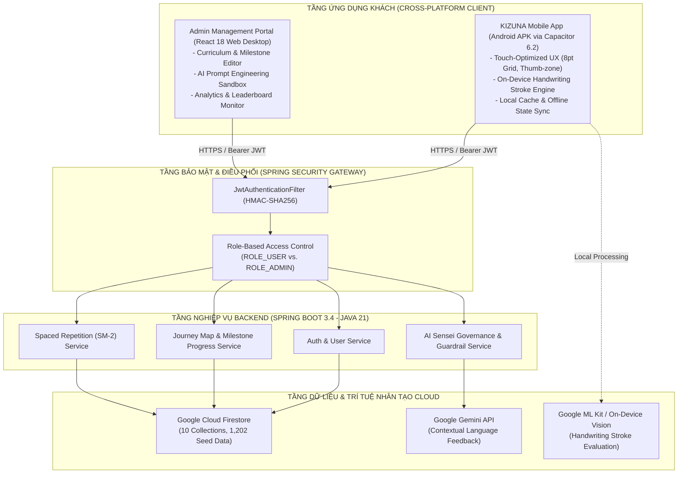

# [REPORT TEMPLATE 1] PROJECT PROPOSAL & INTERACTIVE WIREFRAME PROTOTYPE
**Course:** Cross-Platform Mobile App Development (Phát triển Ứng dụng Di động Đa nền tảng)  
**Project Title:** KIZUNA (絆) - Hành Trình Học Tiếng Nhật Đa Nền Tảng Hỗ Trợ Bởi Trí Tuệ Nhân Tạo / *KIZUNA - Cross-Platform AI-Powered Japanese Learning Journey Application*  
**Team Name:** KIZUNA Dev Team (VKU) • **Academic Term:** Semester 1 (2026 - 2027) • **Deadline:** Week 4  
**Student / Project Lead:** Trần Thanh Phong (Student ID: 23IT - VKU, Email: phongtt.23it@vku.udn.vn, GitHub: @Rynnne3125)  
**Instructor / Advisor:** ThS. Lê Thành Công — Trường Đại học Công nghệ Thông tin và Truyền thông Việt - Hàn (VKU), Đại học Đà Nẵng  

---

## 1. PROJECT MOTIVATION & PROBLEM STATEMENT

### 1.1. Context & Practical Problem Space
Tại Việt Nam, đặc biệt trong khối trường kỹ thuật công nghệ như Đại học Công nghệ Thông tin và Truyền thông Việt - Hàn (VKU), nhu cầu học tiếng Nhật để tham gia các chương trình thực tập (Internship) tại Tokyo, Fukuoka và gia nhập thị trường phần mềm Nhật Bản đang bùng nổ mạnh mẽ. Tuy nhiên, rào cản tiếp cận và tỷ lệ bỏ cuộc của sinh viên là vô cùng nghiêm trọng.

Khảo sát thực tế trên hơn 200 người học tiếng Nhật tự do và sinh viên IT cho thấy:
1. **Sự thất bại của mô hình "Danh sách khóa học tĩnh" (Static Course Lists):** Các ứng dụng hiện nay (như Minna no Nihongo, Mazii, Anki) tiếp cận việc học bằng danh sách hàng chục bài học tĩnh, khô khan. Người học bị cuốn vào tâm lý "cày cuốc lý thuyết" một cách thụ động, cảm thấy ngợp trước 50 bài Minna no Nihongo và 2,000 chữ Kanji mà không biết mình đang đứng ở đâu trong hành trình thực tế.
2. **Tỷ lệ từ bỏ sớm báo động:** Hơn **65% người học bỏ cuộc trong vòng 60 ngày đầu tiên** do thiếu động lực bền vững, thiếu bối cảnh giao tiếp cụ thể và chịu áp lực ghi nhớ quá tải (Cognitive Overload).
3. **Mất kết nối giữa từ vựng và phản xạ giao tiếp:** Người học có thể nhớ mặt chữ Kanji trên flashcard nhưng hoàn toàn lúng túng khi cần ghép câu, giải quyết tình huống giao tiếp đời sống hoặc trao đổi kỹ thuật cơ bản (HORENSO, đổi lịch hẹn, báo cáo tiến độ).
4. **Trí tuệ nhân tạo (AI) bị lạm dụng hoặc tách rời:** Các ứng dụng tích hợp chatbot AI hiện nay thường để AI đàm thoại tự do, dẫn đến hiện tượng "ảo giác" (hallucination), sinh từ vựng vượt cấp độ N5/N4 khiến người học hoang mang; hoặc AI chỉ đóng vai trò dịch thuật máy thô ráp.

**Bước chuyển dịch mô hình sản phẩm (The KIZUNA Paradigm Shift):**  
Dự án **KIZUNA (絆 - Sợi dây gắn kết)** ra đời nhằm định nghĩa lại trải nghiệm học tiếng Nhật đa nền tảng:
* **"Học như một Chuyến đi" (Journey Map Gamification):** Biến toàn bộ lộ trình tiếng Nhật thành một bản đồ thế giới mở (Overworld Journey Map) trải dài từ Hokkaido đến Kyushu. Người học đóng vai trò là một "Lữ khách" (Traveler) vượt qua các vùng đất tri thức.
* **Tổ chức 5 tầng chuẩn hóa:** `Hành trình (Journey)` $\rightarrow$ `Chặng (Stage)` $\rightarrow$ `Mốc (Milestone)` $\rightarrow$ `Bài học (Quests)` $\rightarrow$ `Ôn tập ngắt quãng (SRS Revisit)`.
* **Gameplay phục vụ việc học thực chất:** Người học chỉ mở khóa được mốc mới khi **thực sự ứng dụng được kiến thức** (nghe hiểu, tự ghép câu, vượt qua bài tập tình huống thực tế), thay vì lướt qua màn hình một cách vô thức.
* **AI Sensei có kiểm soát (Controlled AI Guardrails):** Hệ thống tích hợp Trợ lý ảo AI Sensei chấm điểm, phân tích lỗi sai và gợi ý cách diễn đạt tự nhiên dựa trên **danh mục từ vựng chuẩn mực (Knowledge Whitelist)** được chắt lọc từ giáo trình NEJ Vol 1 & 2.

---

### 1.2. Target User Personas

#### Primary Persona: Lữ khách Kỹ thuật Công nghệ (IT Tech Traveler)
* **Họ và tên:** Lê Hoàng Nam
* **Độ tuổi:** 20 tuổi
* **Nghề nghiệp:** Sinh viên năm 2 ngành Kỹ thuật Phần mềm / Công nghệ Thông tin tại VKU (Đà Nẵng).
* **Mục tiêu học tập (User Goals):**
  * Đạt trình độ giao tiếp phản xạ tương đương JLPT N4 - N3 trong vòng 9 tháng.
  * Tự tin phỏng vấn và thích nghi với môi trường làm việc khi đi thực tập doanh nghiệp tại Fukuoka/Tokyo vào năm thứ 3.
  * Duy trì thói quen học tập đều đặn 15–20 phút mỗi ngày trên thiết bị di động mà không bị kiệt sức (burnout).
* **Điểm đau cốt lõi (Key Pain Points):**
  * Đã 3 lần tải app học tiếng Nhật về máy nhưng đều bỏ dở sau 1–2 tuần vì bài học quá khô khan và dồn dập.
  * Học thuộc từ vựng đơn lẻ nhưng khi viết email xin đổi lịch họp hoặc trò chuyện với đồng nghiệp Nhật thì "đóng băng", không biết dùng trợ từ `に`, `で`, `を` sao cho đúng ngữ cảnh.
  * Bị nản lòng khi hệ thống phạt học lại cả bài dài 30 phút chỉ vì quên một chữ Hán tự.

#### Typical User Story: Vòng lặp Học tập tại Mốc "Đổi lịch hẹn"
> *"Là một sinh viên IT chuẩn bị đi thực tập tại Nhật, tôi muốn trải nghiệm một chuỗi thử thách tình huống thực tế về việc đổi lịch hẹn công việc để tôi có thể tự viết được tin nhắn xin lỗi và dời lịch chuẩn tác phong người Nhật, đồng thời nhận phản hồi sửa lỗi tức thì từ AI Sensei."*

**Kịch bản trải nghiệm cụ thể (Workflow):**
1. **Khởi động ứng dụng:** Nam mở ứng dụng KIZUNA trên điện thoại di động Android. Giao diện Bản đồ Hành trình (Japan Overworld Map) mở ra, hiển thị vị trí hiện tại của Nam tại **Chặng 3: Sinh hoạt & Công việc**.
2. **Truy cập Mốc học tập:** Nam chạm vào Mốc học tập đang mở khóa `ms_s3_04_schedule_change` ("Mốc: Đổi lịch hẹn - 都合変更"). Màn hình hiển thị danh sách từ vựng trọng tâm (Knowledge Whitelist) gồm các từ: `都合 (thuận tiện)`, `変更 (thay đổi)`, `よろしいでしょうか (có được không ạ)`.
3. **Thực hiện Vòng lặp 7 bước tại Mốc (Milestone Micro-Loop):**
   * **Bước 1 (Nghe bối cảnh):** Nam bấm nghe đoạn audio hội thoại giữa nhân viên IT và quản lý dự án người Nhật tại Tokyo.
   * **Bước 2 (Nạp mẫu câu cốt lõi):** Nam học các mẫu câu từ chối khéo và đề xuất thời gian mới.
   * **Bước 3 (Phân biệt sắc thái):** Nam làm bài trắc nghiệm phân biệt cách nói lịch sự (Trịnh trọng) và thân mật (Bạn bè).
   * **Bước 4 (Dịch câu phản xạ):** Nam nhanh chóng dịch câu tiếng Việt sang tiếng Nhật với các từ gợi ý.
   * **Bước 5 (Tự viết tin nhắn thực tế):** Hệ thống đưa ra ngữ cảnh: *"Hôm nay bạn bị sốt 39 độ, hãy viết tin nhắn báo cho anh Tanaka xin dời cuộc họp sang 14h chiều mai."* Nam tự gõ câu trả lời tiếng Nhật vào khung nhập liệu.
   * **Bước 6 (AI Sensei Đánh giá & Góp ý):** Hệ thống gửi câu viết của Nam lên API Backend. AI Sensei phân tích câu văn theo whitelist từ vựng, phản hồi tức thời: Khen ngợi cấu trúc ngữ pháp tốt, chỉ ra lỗi dùng nhầm trợ từ `に` thay vì `で`, và gợi ý mẫu câu lịch sự chuẩn văn phòng.
   * **Bước 7 (Thử thách Mini-Boss cuối mốc):** Nam hoàn thành bài kiểm tra tổng hợp mốc đạt 90/100 điểm.
4. **Tích lũy thành tích & Mở khóa:** Nam nhận được **+50 XP** và **+20 Điểm Năng Động (Active Points)**, chuỗi ngày học liên tục (Streak) tăng lên 12 ngày. Mốc tiếp theo trên bản đồ tự động chuyển sang trạng thái `UNLOCKED`. Các từ Nam còn ngập ngừng tự động được thêm vào hàng đợi **Ôn tập ngắt quãng (Spaced Repetition)** để xuất hiện nhắc nhở sau 24 giờ.

---

## 2. SYSTEM SCOPE & FUNCTIONAL SPECIFICATIONS

Bảng đặc tả phạm vi chức năng của hệ thống KIZUNA được phân loại theo mức độ ưu tiên theo chuẩn MoSCoW:

| # | Feature Category | Concrete Feature | Priority | Business Logic & Scope |
|:---:|---|---|:---:|---|
| **1** | **Authentication & User Profile** | OAuth Sign-in (Google / Firebase Auth) & JWT Stateless RBAC | **Must-Have** | Đăng nhập an toàn qua Google OAuth và email/password. Backend Spring Security cấp phát JWT Bearer Token (HMAC-SHA256). Phân quyền 2 vai trò: `ROLE_USER` (học viên) và `ROLE_ADMIN` (quản trị viên). Quản lý hồ sơ cá nhân: Avatar, Cấp độ JLPT, Tổng XP, Điểm Năng Động (Active Points), và Chuỗi ngày học (Daily Streak). |
| **2** | **Core Learning Engine (Journey Map)** | Bản đồ Hành trình 5 tầng & Vòng lặp Nhiệm vụ tại Mốc | **Must-Have** | Mô hình 4 Chặng lớn (Hokkaido $\rightarrow$ Okinawa), 28 Mốc học tập, 112 Bài học (Quests). Trạng thái mốc chuyển dịch: `LOCKED` $\rightarrow$ `UNLOCKED` $\rightarrow$ `IN_PROGRESS` $\rightarrow$ `COMPLETED`. Mỗi mốc điều phối 4 nhiệm vụ con: (1) Thẻ từ SRS Flashcard, (2) Cổng kiểm tra từ vựng Vocab Gatekeeper, (3) Ghép câu ngữ pháp Grammar Scramble, (4) Tình huống thực hành ứng dụng. |
| **3** | **Artificial Intelligence (AI)** | Trợ lý AI Sensei phản hồi tức thời & Nhận diện chữ viết On-Device | **Must-Have** | Tích hợp Google Gemini API qua Backend có kiểm soát: Đối sánh câu trả lời mở của người học với danh mục từ vựng cho phép (Knowledge Whitelist) của mốc, phát hiện lỗi sai trợ từ, giải thích ngữ pháp bằng tiếng Việt tự nhiên trong thời gian $< 2.5\text{s}$. Tích hợp bộ nhận diện nét vẽ chữ Hán/Kana trên thiết bị (On-Device Canvas Stroke Recognition / Google ML Kit). |
| **4** | **Offline Resilience & Data Sync** | Bộ nhớ đệm cục bộ (Local Caching) & Tự động đồng bộ ngầm | **Should-Have** | Hỗ trợ lưu trữ tiến độ học tập và bản nháp câu trả lời vào LocalStorage / IndexedDB trên thiết bị di động. Khi mất kết nối Internet, người học vẫn có thể học flashcard và làm bài ngoại tuyến. Hệ thống tự động đẩy dữ liệu đồng bộ lên Google Cloud Firestore ngay khi có mạng trở lại mà không xung đột dữ liệu. |
| **5** | **Spaced Repetition (SRS)** | Hàng đợi Ôn tập Ngắt quãng SuperMemo-2 (SM-2) | **Should-Have** | Thuật toán SM-2 tự động theo dõi lịch sử làm bài. Mọi từ vựng hoặc chữ Hán làm sai trong vòng lặp mốc sẽ tự động đưa vào hàng đợi `user_srs_items`. Tự động tạo "Nhiệm vụ quay lại luyện tập" (Spaced Re-engagement Quest) trên bản đồ sau 1, 3, 7, 14, 30 ngày. |
| **6** | **Gamification & Social** | Bảng xếp hạng Thời gian thực & Huy hiệu Wa-Modern | **Should-Have** | Hệ thống tính điểm Năng Động (Active Points) chống gian lận. Bảng xếp hạng Top 50 cập nhật theo thời gian thực (Real-time Leaderboard). Giao diện vinh danh mang phong cách mỹ thuật truyền thống Nhật Bản (Wa-Modern), con dấu Hanko đỏ và huy hiệu gia tộc (Mon crests). |
| **7** | **Admin Curriculum Management** | Bảng điều khiển Quản trị Lộ trình & Kiểm duyệt AI | **Could-Have** | Cổng quản trị dành cho giáo viên trên Web Desktop: Quản lý CRUD 4 Chặng, 28 Mốc, 1,202 bản ghi dữ liệu hạt nhân giáo trình NEJ (Từ vựng, Chữ Hán, Ngữ pháp); Sandbox thử nghiệm và tinh chỉnh Prompt AI Sensei; Xem biểu đồ phễu rơi rụng người học (Drop-off funnel). |

---

## 3. TECH STACK & INITIAL ARCHITECTURE

### 3.1. Danh mục Công nghệ Lựa chọn (Technology Stack)
* **Mobile / Frontend Framework:** React 18 + TypeScript + Vite, đóng gói đa nền tảng cho thiết bị di động Android APK thông qua **Capacitor 6.2** (Hỗ trợ đóng gói native Android, tối ưu cảm ứng và hiệu năng 60 FPS).
* **Styling & Design System:** Tailwind CSS v3.4 + Radix UI Primitives + Framer Motion (Hoạt ảnh tương tác mượt mà). Mỹ thuật Wa-Modern kết hợp Hệ thống lưới 8-Point Grid.
* **State Management:** Custom Hook Controllers (`useAuth`, `useProgress`, `useAdminData`) kết hợp bộ nhớ đệm `localStorage` / `IndexedDB` client-side.
* **Backend Services:** Java 21 LTS + **Spring Boot 3.4.2** kiến trúc RESTful Enterprise, quản lý build qua Gradle 8.x.
* **Security & Authentication:** Spring Security với cơ chế **Stateless JWT (JJWT 0.12.6)**, mã hóa mật khẩu `BCryptPasswordEncoder`, tích hợp Firebase Authentication với Custom Claims cho phân quyền RBAC.
* **Database & Cloud Infrastructure:** **Google Cloud Firestore** (Cơ sở dữ liệu NoSQL phân tán thời gian thực), Firebase Hosting, Firebase Storage lưu trữ audio/media.
* **AI & Machine Learning Engine:** 
  * Cloud Generative AI: Google Gemini 1.5/2.0 API tích hợp tầng kiểm soát (Guardrail Whitelist) tại Backend Spring Boot.
  * On-Device Vision / Handwriting: Google ML Kit & Thuật toán phân tích vector nét vẽ (Stroke-order Canvas Engine) chạy cục bộ trên điện thoại.

---

### 3.2. Bản mẫu Tương tác & Quy chuẩn Thiết kế Wireframe (Interactive Prototype)
* **Quy chuẩn Không gian & Giao diện:** Thiết kế theo nguyên lý **Mobile-First**, kích thước khung cơ sở **390px $\times$ 844px** (tỷ lệ vàng của iPhone 13/14/15 và các thiết bị Android tiêu chuẩn), padding và margin tuân thủ nghiêm ngặt **bội số 8 (8-Point Grid)**.
* **Tối ưu hóa Vùng Ngón Tay Cái (Thumb-Zone Optimization):** Các nút CTA cốt lõi (Nút "Tiếp tục", "Gửi Sensei chấm", "Lật thẻ", "Nghe lại") được bố trí cố định ở thanh Sticky Bottom Bar ($1/3$ dưới màn hình), giúp người dùng dễ dàng thao tác bằng một tay khi đang di chuyển trên xe buýt hoặc đi bộ trong khuôn viên trường.
* **Cấu trúc 5 Màn hình Bản mẫu Chính:**
  1. **Màn hình Bản đồ Thế giới (Japan Overworld Map):** Bản đồ vẽ các chặng và các nút mốc dạng node game RPG. Có phân biệt trực quan trạng thái khóa/mở và cờ báo nhiệm vụ ôn tập ngắt quãng (Revisit badge).
  2. **Màn hình Vòng lặp Nhiệm vụ Mốc (Milestone Quest Runner):** Thanh tiến độ bước 1/7 $\rightarrow$ 7/7, hộp phát âm thanh bối cảnh, các chip từ vựng Whitelist, khung nhập câu trả lời tiếng Nhật có tích hợp bàn phím ảo Kana.
  3. **Màn hình AI Sensei Feedback Drawer:** Ngăn kéo trượt từ dưới lên (Bottom Sheet) hiển thị nhận xét của giáo viên AI, tô màu xanh cho trợ từ đúng, màu cam cho chỗ cần cải thiện, kèm nút nghe phát âm câu sửa đổi.
  4. **Màn hình Thẻ học Flashcard SRS:** Lật thẻ từ vựng/kanji hai mặt mượt mà, có hỗ trợ thao tác vuốt (Swipe Left: Chưa thuộc, Swipe Right: Đã nhớ) để cập nhật thuật toán SuperMemo-2.
  5. **Màn hình Bảng vinh danh & Hồ sơ:** Hiển thị chuỗi ngày học liên tục (Streak), con dấu thành tích Hanko, cấp bậc lữ khách và bảng xếp hạng Top người học trong tuần.
* **🔗 Liên kết Bản mẫu Tương tác Figma (Interactive Prototype URL):**  
  [https://www.figma.com/design/kizuna-mobile-prototype-v2/KIZUNA-Journey-Map](https://www.figma.com/design/kizuna-mobile-prototype-v2/KIZUNA-Journey-Map)  
  *(Nguyên mẫu tương tác cho phép nhấp chọn trực tiếp từng nút mốc trên bản đồ, trải nghiệm luồng làm bài 7 bước tại Mốc Đổi lịch hẹn và xem phản hồi tương tác mô phỏng của AI Sensei).*
